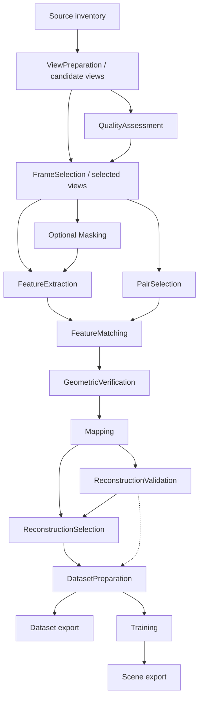

# Architecture

## Status and product boundary

This document describes the target architecture and the boundaries that implemented
milestones must preserve. M0-M6.5 provide the current local persistence, media, execution,
view/quality selection, capability-diagnostic and PairSet foundations. M7a adds
local-feature extraction through the same execution boundary. M7b adds separate raw
matching and geometric verification artifacts plus versioned feature/matching profiles.
M7c adds neutral offline retrieval representations, bounded retrieval/hybrid PairSets
and an M7b benchmark harness; production retrieval inference/selection remains pending.
See [M7c contracts](docs/M7C.md). Later contracts
remain staged by the [roadmap](ROADMAP.md). The historical
[review](docs/ARCHITECTURE_REVIEW.md) records the reasoning behind the foundation and
intentionally deferred choices.

SplatForge owns project intent, orchestration, provenance, diagnostics and a convenient
local workflow. It delegates media processing, SfM and Gaussian optimization to
replaceable methods. The long-term product spans import, quality control,
reconstruction, training and viewing; the first deliverable stops at a validated
training dataset. Windows-first, local-first desktop use remains the primary product
and implementation path. No cloud service or account is required for ordinary local
runs; future remote execution must remain optional rather than becoming a prerequisite.

Phase 1 supports perspective photos and videos from multiple devices and clips.
Camera calibration, distortion, image orientation and source chronology are explicit.
Photogrammetric scale is unknown unless established by a recorded measurement or
alignment; GPS presence alone does not establish accuracy or metric scale.

## Dependency direction

```text
CLI / future Desktop GUI / future API or SDK clients
                         |
                         v
Application services -----> Core domain and contracts
          ^                         ^
          | injected implementations|
Storage / process / media / SfM / trainer adapters

Composition root constructs services and adapters.
```

| Boundary | Owns | Must not own |
| --- | --- | --- |
| Core | Typed configurations, IDs, artifact metadata, compatibility rules, dependency/fingerprint rules | UI, filesystem I/O, database connections, subprocesses, heavy backend imports |
| Application | Create/open/plan/run/cancel/retry/diagnose use cases, orchestration, publication policy | Widget state, transport-specific presentation or vendor command syntax |
| Adapters | Storage, discovery, process management, FFmpeg, COLMAP, learned libraries, trainers, format conversion | Product defaults or silent fallback decisions |
| Clients (CLI/GUI; future API/SDK) | Input presentation, user choices, event rendering or transport mapping | Processing, cache decisions, direct backend invocation |
| Composition root | Explicit dependency wiring and built-in method factories | Business rules or mutable global registry |

Introduce packages and abstractions only when their first concrete use cases arrive. Do
not create a package for every noun. Core may use Pydantic and `Path` values without
performing I/O. Storage interfaces belong to the application; artifact and method
contracts belong to core. Concrete adapters depend inward, never the reverse.

## Deployment, client and storage neutrality

The current implementation is intentionally a local Windows application with local
project storage, one project writer and locally owned worker processes. Those are the
first concrete adapters and operating constraints, not permanent assumptions of every
Core or Application contract.

Preserve these future options without implementing them now:

- Application use cases and typed domain contracts must not require the caller to be a
  PySide6 widget or even a desktop process. CLI and the future desktop GUI are clients of
  the same services; a later REST/API server, Python SDK, Unreal integration or other
  production tool may map its requests to those services instead of automating UI state.
- Processing locality is an adapter/composition decision. The supported path today is
  `this computer`; a later concrete deployment may route work to a company GPU server,
  remote worker or cloud-hosted worker while preserving the same project intent,
  artifact lineage, cancellation semantics and typed processing results where those
  contracts still apply. Do not add a distributed scheduler or remote protocol before a
  real deployment requires one.
- Execution events, progress, status, warnings and cancellation belong to the
  application/execution model, not to a progress bar. A CLI renderer, desktop UI,
  future HTTP/WebSocket endpoint or other client decides how to present the same
  committed state and structured events.
- Data identity is separate from physical location. `ProjectId`, `SourceId`, view IDs,
  artifact IDs, semantic digests and lineage do not derive identity from an absolute
  `C:\...` path. Local/UNC paths are concrete locators today; NAS, managed copies,
  object storage or remote artifact stores require concrete future adapters and
  consistency rules rather than a speculative generic storage framework now.
- A future remote deployment may need different ownership, lease, transport and storage
  mechanisms than the current `project.lock` and local filesystem. Preserve the
  semantic guarantees—single authoritative publication decisions, immutable artifacts,
  explicit cancellation and reproducible lineage—without treating the current local
  lock/file implementation as a universal distributed protocol.

This neutrality does not make cloud, server, REST, SDK, S3, mobile, multi-worker or
hosted-scene functionality part of M1-M12. The rule is **preserve the option, do not
implement the option**. Add a new transport/storage/execution abstraction only when a
concrete second deployment demonstrates a missing boundary in the current contracts.

## Domain vocabulary

- **Source**: an original file with stable content identity and a separately stored
  locator. **Source group**: a clip/session/import grouping; not a calibration group.
- **Camera group**: observations that may share intrinsics under a declared model
  and policy. Resolution, zoom, crop, stabilization and lens changes can require new
  groups. Do not infer shared intrinsics from filenames or one import batch.
- **View**: an image observation with source provenance, dimensions, orientation,
  timestamp where applicable and camera reference. Future projected 360 views also
  carry parent capture and projection transforms.
- **Stage**: a semantic operation with an input/output contract. **Method**: an
  algorithm choice. **Backend/adapter**: an implementation/runtime for that choice.
  One backend may implement several stages without merging their contracts.
- **Artifact**: a validated, immutable published result with a manifest. Large
  arrays, images and native models remain on disk, referenced by typed handles.
- **Run**: a frozen resolved plan/configuration. **Attempt**: one execution of one
  stage or explicit fused operation in that run. Retrying creates another attempt,
  not overwritten history.

## Processing boundaries

The application constructs a small explicit acyclic plan in Python, not a workflow
language or a single mutable "pipeline database". Semantic operation kind and plan
node ID are distinct: one operation may appear once per source or selected component. [PIPELINE.md](docs/PIPELINE.md) owns the detailed contracts.



The dashed edge is an eligibility gate; it does not transform reconstruction data.
This diagram omits optional dependencies: retrieval may consume feature or embedding
artifacts; geometric verification consumes camera assumptions; training may consume
its own masks. Such dependencies must be declared, not inferred from stage order.

Decoding determines the candidate pool. Quality measurement produces scores;
selection chooses a subset and records rejection reasons. Pair selection proposes
image pairs; matching produces descriptor correspondences; geometric verification
produces verified constraints. Mapping builds cameras/poses/points. Validation
reports quality without mutating reconstruction. A small application decision publishes
ReconstructionSelection with component IDs, manual/policy provenance and the report
evidence used; it never silently chooses the largest component. Dataset preparation
consumes that selection and handles undistortion, resizing, coordinate conversion and
trainer input layout explicitly. Multiple unaligned components remain separate datasets.

The diagram is the initial sparse-feature route, not a mandatory interface for every
future algorithm. A detector-free matcher may consume views and emit correspondences;
an alternative SfM system may consume views/priors and emit ReconstructionSet directly.
Add a specific typed route only when implementing that backend. Do not fabricate
FeatureSet, PairSet or verified-geometry outputs it cannot supply. Consumers still use
the reconstruction/validation/dataset contracts; capabilities state which metrics and
constraints are available. Unavailable intermediate metrics remain unknown.

An explicitly selected native operation may cover several semantic stages. Its plan
entry lists covered operations, real inputs/outputs, consumed settings and one recipe
key over all of them. It publishes one validated output bundle and resumes as a unit.
If it controls pairing internally, the route cannot claim to honor an external PairSet;
reject that requested combination or select the native route explicitly. Never treat
this as a silent fallback. No optimizer or framework for arbitrary stage fusion.

## Replaceable methods and capability checks

Keep the built-in registry small and explicitly injected. A registration must connect
metadata and a versioned settings schema to an implementation factory. Catalog-only
entries remain labeled planned. No third-party plugin loader is needed initially.

Validation has three levels:

1. **Configuration**: check every role separately, known settings, parameter bounds,
   input/output contracts and descriptor/model/camera compatibility.
2. **Environment**: probe executable/library identity, supported operations, model
   files, devices and runtime health. Report available, unavailable or unknown, with
   evidence and a reason. Unknown is not runnable.
3. **Plan**: resolve methods, input artifacts, resources, dependencies and required
   conversions for this project. Reject incompatibility before expensive execution.

Validate the requested target and its required operations, not every saved method.
Published inputs can be consumed without their producing backend installed; current
readers/validators and operations actually scheduled still need working capabilities.
Cache reuse does not certify that the original producer could be executed now.

LoMa, ALIKED + compatible LightGlue and SIFT + brute-force are first-class supported
feature/matching families. Versioned Simple profiles express speed/quality intent and
resolve deterministic candidates before execution; Advanced exposes compatible typed
choices without fallback. Current saved explicit ALIKED intent remains explicit.
M8a implements COLMAP Global Mapper with all-component ReconstructionSet v1 and a
backend-neutral reader, tested >=4.2.1 capability gating, private DB isolation and optional
explicit view-graph calibration. Preserve-priors remains the conservative default.
M8b1 adds explicit single-model Incremental Ceres CPU and capability-gated Caspar BA.
Overlapping native Incremental hypotheses are refused; all unregistered views remain explicit.
Both routes use unchanged ReconstructionSet v1/Reader and the same private DB boundary.
Hierarchical/Global GPU/comparison remain M8b2. No profile selects a mapper.
See [M8a contracts](docs/M8A.md) and [M8b1](docs/M8B1.md).

The documented COLMAP learned route depends on build options, including ONNX support;
it is not guaranteed by the executable name or version alone. This motivates probing,
not a requirement that every learned method use COLMAP's ONNX implementation.
See [COLMAP's feature guidance](https://colmap.github.io/faq.html#choosing-between-sift-aliked-and-loma-features).

M7a supports SIFT, ALIKED_N16ROT, optional ALIKED_N32, LOMA_B and LOMA_B128 as explicit
extraction routes. LoMa requires COLMAP >=4.2.1 and positively verified local
detector/descriptor/ONNX inference; its version or help tokens alone are insufficient.
Compatible older SIFT/ALIKED routes remain supported. LoMa-B and LoMa-B128 are distinct
descriptor families; LoMa-R/L/G are implemented M7b matchers. LoMa-R is an explicit
rotation-robust Advanced choice, not a generic quality rung. Existing end-to-end SfM defaults
stay unchanged. Local weights are pinned by source/name and SHA-256 before execution,
without implicit downloads or a base Python ML-runtime/PyTorch dependency. Model
provenance supports a later installer-license audit and does not grant redistribution rights.

M5 implements this environment boundary as a project-free Doctor report. Static
CLI evidence is short-lived, resource/GPU health is shorter-lived, and cached evidence
is reused only while the same concrete executable identity remains observed. Deep
native database and SIFT checks use owned temporary workspaces through the shared
process boundary. Raw newer backend commands and feature/matcher tokens are
informational; they neither mutate the method catalog nor promise pipeline support.

On Windows the COLMAP adapter recognizes bounded official-style portable layouts,
using `COLMAP.bat` only as an inert installation locator. Every help/deep probe executes
the same native executable with one child-scoped runtime environment. Typed runtime
layout evidence is separate from native byte identity and excludes inherited PATH.
Unrecognized native installations retain their caller environment, without guessed
sibling runtime directories. No wrapper execution or global environment mutation.

Descriptor compatibility includes family, representation, dimensions, normalization,
keypoint convention and matcher weight variant. Retrieval/Vocabulary Tree is not a
universal operation over every local descriptor family. Keep retrieval model/index
requirements explicit; ALIKED local descriptors are not automatically retrieval
embeddings. M7c delivers a practical representation/index and bounded hybrid pairing:
Sequential within clips plus retrieval across clips, before the complete multi-video
CLI. GPS/spatial pairing and advanced retrieval optimization remain later.

## Backend artifact ownership

COLMAP's database and sparse files are adapter-owned payloads behind manifest contracts.
Do not force all algorithms into a universal tensor store, or make every consumer
understand COLMAP internals. Define portable metadata plus versioned payload formats;
implement conversion only when a real consumer requires it. M8a exposes a small reconstruction
adapter reader for view/camera/pose/component records,
with declared conventions and explicit optional-record availability. M8a point/track streaming
is not_published; native point counts are measured. Validation and dataset preparation
must not parse COLMAP files themselves. Do not build a universal feature-array store.

Separate application `state.sqlite` from every COLMAP database. Isolate databases by
feature identity and compatible processing branch. Copy or rebuild a native database
into an attempt workspace before a later operation mutates it. Never let matching or
mapping alter a published upstream database. Record SplatForge-to-native image/camera
ID mappings. Validate schema, coordinates, descriptors and verified geometry at import.
COLMAP distinguishes raw matches from the two-view geometry used by reconstruction;
that distinction is part of the adapter contract.
See [COLMAP database format](https://colmap.github.io/database.html).

M7b implements independent `FeatureMatching` and `GeometricVerification` semantic
stages and frozen `matches.run` / `verification.run` routes. `MatchSet` v1 binds every
requested PairSet edge, including zeros, to canonical UUID-index correspondences.
`VerifiedGeometrySet` v1 explains every upstream pair and binds camera-prior identity
only at verification. Neither stage mutates a published upstream database. Numerical
digests exclude SQLite layout, native IDs, paths, timestamps and profile labels.
Matching uses the verified explicit-pair importer with verification disabled;
standalone verification assembles current perspective camera inputs in a private copy.
Full contracts and limitations are in [M7B.md](docs/M7B.md).

Simple resolution uses route-specific `auto` device policy: GPU, then positively
supported CPU for that same candidate, then the next technology. Advanced `auto`
changes device only; explicit CPU/GPU choices never substitute another device or
algorithm. Concrete device settings are frozen before attempts. Requested policy and
profile labels are provenance; actual device/runtime/settings retain numerical and
performance identity. Performance history never selects algorithms or devices.

Never hardlink a writable native database or hand a published file to a tool that may
open it for writing. Close/checkpoint native writers before a consistent copy; include
required sidecars or use the backend's supported snapshot mechanism. A readonly file
attribute alone is not isolation. Current calibration/priors belong to downstream
assembly: update a private database copy from the current camera inputs even when
reusing pixel features. If extraction really consumes calibration/gravity metadata,
those fields belong in its key. Native feature-row IDs must remain mapped to view IDs.

## State, reproducibility and execution

[PROJECT_FORMAT.md](docs/PROJECT_FORMAT.md) owns storage and recovery. Fingerprints
follow actual input dependencies, so training changes cannot invalidate frames or SfM.
Invalidation makes artifacts ineligible for a new plan; it does not delete history.
Reuse requires compatible provenance and validated output integrity, not just a key.
Sources are fully hashed at ingest. Later runs default to recorded Balanced/local
verification using metadata/identity/change indicators, with full rehash on suspicion
or insufficient evidence; Strict rehashes complete content and maintains stable bytes
through consumption. The run/attempt records assurance
and limitations, and stronger verification gates cannot silently upgrade weak provenance.
See [source verification](docs/PROJECT_FORMAT.md#source-verification-policies).

Record resolved settings/defaults, source and model digests, adapter/backend identity,
seeds, device/runtime information, input/output lineage and exact invocation metadata.
Reproducibility means an inspectable, repeatable recipe with declared numerical
limitations; GPU/SfM/training results are not promised to be bit-for-bit deterministic.

For the current local project implementation, start with one writer and one active stage
per project. The owner holds the project lock; other clients can inspect committed
status and request cancellation without writing SQLite. Settings saves while a run is
active return busy in the initial implementation. Use a synchronous application runner
off the GUI thread, with owned worker processes for native/GPU work. These are local
execution mechanics, not requirements that every future deployment share a filesystem,
process or lock implementation. No service, distributed scheduler, event-sourcing
platform or cross-project cache is required now.
Stage-boundary restart is required from the first processing milestone. Backend
checkpoint resume is an additional capability, not a universal promise.

## Progress and runtime estimation

M6.5 makes semantic progress application/execution state shared by CLI, future desktop,
API and web clients. Core owns immutable versioned work descriptions, observations,
snapshots, ETA/confidence and performance signatures. Application owns live estimation,
duration-weighted pipeline aggregation and successful-sample eligibility. Adapters own
hardware classification, private history persistence and backend progress extraction.
Clients only render these values; no widget or transport belongs to the contracts.

ETA is derived diagnostic evidence, never numerical identity. History cannot select a
method, change settings, recipe keys, semantic digests, outputs or cache eligibility.
Deleting it only removes prediction evidence. The executing worker's hardware/runtime
classifies each sample; today's worker is local. Future remote workers can emit the same
observations without assuming that a desktop client performed the work. This preserves
the deployment options above without adding remote execution or scheduling.

Stages without a defensible total expose indeterminate or phase-scoped work. Mapping
must not invent linear percentages. M8a explicitly opts into complete-job historical
planning ranges at low/medium confidence; ordinary phase totals still do not authorize
ETA. M7 features/matching/verification use this foundation;
M11 managed training must integrate with it later. Matching and verification expose
real phases, exact planned pair totals, observed completion after output validation,
and separate historical ETA signatures. Backend logs do not fabricate pair percentages.
See [work models and estimator rules](docs/DEVELOPMENT.md#progress-and-eta-foundation).

## Training, legacy work and future inputs

Dataset preparation is independently useful: external LichtFeld handoff must work
without pretending an external/manual run is managed training. Managed trainers
implement start/progress/cancel/results and, only where supported, checkpoint resume.
gsplat is a potential trainer implementation dependency; its name alone does not
specify a complete training recipe. Keep optimizer, densification, loss, schedule,
camera conventions and output formats explicit in the trainer contract.

The developer's earlier successful 3DGS project may be inspected read-only at any
milestone as optional, non-blocking research. Record versions, parameters, preprocessing,
camera/scale assumptions, hardware and evidence in
[LEGACY_3DGS_RESEARCH.md](docs/LEGACY_3DGS_RESEARCH.md). Its availability never blocks
early implementation. M11 translates available evidence into candidate presets and
benchmarks them before adoption as official versioned presets. If evidence is missing,
record the gap and proceed with independently validated defaults. Do not import that
project's internals as SplatForge core or label it obsolete.

Later 360 preprocessing emits perspective views with virtual intrinsics, projection,
parent capture, timestamps and optional rig relationships. Avoid treating simultaneous
views from one center as independent translational evidence. A mapper without needed
rig support must reject the plan or expose a documented limitation. The existing
flat-camera contracts remain usable. GPS, LiDAR, masks and alignment attach as explicit
metadata/artifacts with units, uncertainty and coordinate frames, never hidden inputs.
Preserve observation time, sensor/rig relationships, pose direction/axis conventions
and transform provenance when present. LiDAR is a geometry/prior input, not a fake
image source. Only a backend declaring support may consume such constraints; unknown
models/constraints must not be silently ignored. Projection is the first 360 route,
not a promise that every future spherical or sensor-fusion method fits preprocessing.

A future spatial route may also begin from an existing point cloud, trajectory or
multi-sensor reconstruction and publish the typed reconstruction/alignment result needed
by downstream validation, dataset preparation, training or export. Do not force such a
route through Photo/Video -> FeatureSet -> PairSet -> COLMAP when those intermediates do
not exist. Add point-cloud, LiDAR, IMU, GNSS/RTK or SLAM contracts only with a concrete
consumer/backend and explicit frames, units, uncertainty and transform provenance; do
not create a generic sensor framework in anticipation of one.

Deferred implementation choices and non-goals are listed in the [review](docs/ARCHITECTURE_REVIEW.md#intentionally-deferred).
