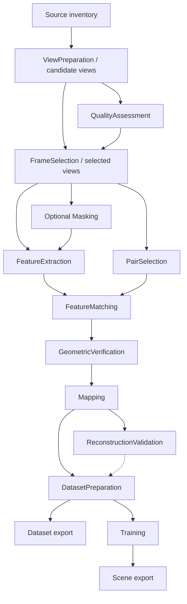

# Architecture

## Status and product boundary

This document describes the target architecture. The current code is a configuration
and CLI foundation, not an implementation of these contracts. The [review](docs/ARCHITECTURE_REVIEW.md)
records what must change; the [roadmap](ROADMAP.md) stages adoption.

SplatForge owns project intent, orchestration, provenance, diagnostics and a convenient
local workflow. It delegates media processing, SfM and Gaussian optimization to
replaceable methods. The long-term product spans import, quality control,
reconstruction, training and viewing; the first deliverable stops at a validated
training dataset. No cloud service or account is required for ordinary local runs.

Phase 1 supports perspective photos and videos from multiple devices and clips.
Camera calibration, distortion, image orientation and source chronology are explicit.
Photogrammetric scale is unknown unless established by a recorded measurement or
alignment; GPS presence alone does not establish accuracy or metric scale.

## Dependency direction

```text
CLI / future PySide6 GUI
          |
          v
Application services -----> Core domain and contracts
          ^                         ^
          | injected implementations|
Storage / process / media / SfM / trainer adapters

Composition root constructs services and adapters.
```

| Boundary | Owns | Must not own |
| --- | --- | --- |
| Core | Typed configurations, IDs, artifact metadata, compatibility rules, dependency/fingerprint rules | UI, filesystem I/O, database connections, subprocesses, heavy backend imports |
| Application | Create/open/plan/run/cancel/retry/diagnose use cases, orchestration, publication policy | Widget state or vendor command syntax |
| Adapters | Storage, discovery, process management, FFmpeg, COLMAP, learned libraries, trainers, format conversion | Product defaults or silent fallback decisions |
| CLI/GUI | Input presentation, user choices, event rendering | Processing, cache decisions, direct backend invocation |
| Composition root | Explicit dependency wiring and built-in method factories | Business rules or mutable global registry |

Introduce `application/` and `adapters/` when their first use cases arrive. Do not
create a package for every noun now. Core may use Pydantic and `Path` values without
performing I/O. Storage interfaces belong to the application; artifact and method
contracts belong to core. Concrete adapters depend inward, never the reverse.

## Domain vocabulary

- **Source**: an original file with stable content identity and a separately stored
  locator. **Source group**: a clip/session/import grouping; not a calibration group.
- **Camera group**: observations that may share intrinsics under a declared model
  and policy. Resolution, zoom, crop, stabilization and lens changes can require new
  groups. Do not infer shared intrinsics from filenames or one import batch.
- **View**: an image observation with source provenance, dimensions, orientation,
  timestamp where applicable and camera reference. Future projected 360 views also
  carry parent capture and projection transforms.
- **Stage**: a semantic operation with an input/output contract. **Method**: an
  algorithm choice. **Backend/adapter**: an implementation/runtime for that choice.
  One backend may implement several stages without merging their contracts.
- **Artifact**: a validated, immutable published result with a manifest. Large
  arrays, images and native models remain on disk, referenced by typed handles.
- **Run**: a frozen resolved plan/configuration. **Attempt**: one execution of one
  stage in that run. Retrying creates another attempt, not overwritten history.

## Processing boundaries

The application schedules a small explicit dependency graph, not a single mutable
"pipeline database". [PIPELINE.md](docs/PIPELINE.md) owns the detailed contracts.



The dashed edge is an eligibility gate; it does not transform reconstruction data.
This diagram omits optional dependencies: retrieval may consume feature or embedding
artifacts; geometric verification consumes camera assumptions; training may consume
its own masks. Such dependencies must be declared, not inferred from stage order.

Decoding determines the candidate pool. Quality measurement produces scores;
selection chooses a subset and records rejection reasons. Pair selection proposes
image pairs; matching produces descriptor correspondences; geometric verification
produces verified constraints. Mapping builds cameras/poses/points. Validation
reports quality without mutating reconstruction. Dataset preparation handles
undistortion, resizing, coordinate conversion and trainer input layout explicitly.

An adapter may use one native operation for matching plus verification, or for media
decoding plus scoring, but must declare this coupling and its real cache granularity.
Do not claim independent reuse if the backend cannot expose intermediate outputs.
Start with separate execution where practical; no generic optimizer for fused stages.

## Replaceable methods and capability checks

Keep the built-in registry small and explicitly injected. A registration must connect
metadata and a versioned settings schema to an implementation factory. Catalog-only
entries remain labeled planned. No third-party plugin loader is needed initially.

Validation has three levels:

1. **Configuration**: check every role separately, known settings, parameter bounds,
   input/output contracts and descriptor/model/camera compatibility.
2. **Environment**: probe executable/library identity, supported operations, model
   files, devices and runtime health. Report available, unavailable or unknown, with
   evidence and a reason. Unknown is not runnable.
3. **Plan**: resolve methods, input artifacts, resources, dependencies and required
   conversions for this project. Reject incompatibility before expensive execution.

ALIKED + compatible LightGlue is the preferred learned route; COLMAP Global Mapper
is the preferred mapper. Selection depends on verified installed capabilities and
dataset suitability. SIFT with compatible brute-force matching and COLMAP
Incremental/Hierarchical Mapper remain explicit alternatives. An automatic profile
may propose a fallback; execution records the resolved choice and never substitutes
another algorithm inside an attempt.

The documented COLMAP learned route depends on build options, including ONNX support;
it is not guaranteed by the executable name or version alone. This motivates probing,
not a requirement that every learned method use COLMAP's ONNX implementation.
See [COLMAP's feature guidance](https://colmap.github.io/faq.html#choosing-between-sift-aliked-and-loma-features).

Descriptor compatibility includes family, representation, dimensions, normalization,
keypoint convention and matcher weight variant. Retrieval/Vocabulary Tree is not a
universal operation over every local descriptor family. Keep retrieval model/index
requirements explicit and allow an independent embedding method when implemented.

## Backend artifact ownership

COLMAP's database and sparse files are adapter-owned payloads behind manifest contracts.
Do not force all algorithms into a universal tensor store, or make every consumer
understand COLMAP internals. Define portable metadata plus versioned payload formats;
implement conversion only when a real consumer requires it.

Separate application `state.sqlite` from every COLMAP database. Isolate databases by
feature identity and compatible processing branch. Copy or rebuild a native database
into an attempt workspace before a later operation mutates it. Never let matching or
mapping alter a published upstream database. Record SplatForge-to-native image/camera
ID mappings. Validate schema, coordinates, descriptors and verified geometry at import.
COLMAP distinguishes raw matches from the two-view geometry used by reconstruction;
that distinction is part of the adapter contract.
See [COLMAP database format](https://colmap.github.io/database.html).

## State, reproducibility and execution

[PROJECT_FORMAT.md](docs/PROJECT_FORMAT.md) owns storage and recovery. Fingerprints
follow actual input dependencies, so training changes cannot invalidate frames or SfM.
Invalidation makes artifacts ineligible for a new plan; it does not delete history.
Reuse requires compatible provenance and validated output integrity, not just a key.

Record resolved settings/defaults, source and model digests, adapter/backend identity,
seeds, device/runtime information, input/output lineage and exact invocation metadata.
Reproducibility means an inspectable, repeatable recipe with declared numerical
limitations; GPU/SfM/training results are not promised to be bit-for-bit deterministic.

Start with one writer and one active stage per project. Use a synchronous application
runner with event/cancellation interfaces; a GUI later moves it off the UI thread.
No distributed scheduler, event-sourcing platform or cross-project cache is needed.
Stage-boundary restart is required from the first processing milestone. Backend
checkpoint resume is an additional capability, not a universal promise.

## Training, legacy work and future inputs

Dataset preparation is independently useful: external LichtFeld handoff must work
without pretending an external/manual run is managed training. Managed trainers
implement start/progress/cancel/results and, only where supported, checkpoint resume.
gsplat is a potential trainer implementation dependency; its name alone does not
specify a complete training recipe. Keep optimizer, densification, loss, schedule,
camera conventions and output formats explicit in the trainer contract.

Before choosing training defaults, inspect the developer's earlier successful 3DGS
project read-only. Inventory versions, parameters, preprocessing, camera/scale
assumptions, hardware and evidence. Translate useful recipes into versioned presets
with provenance and explicit overrides; validate them on small reference scenes.
Do not import that project's internals as SplatForge core or label it obsolete.

Later 360 preprocessing emits perspective views with virtual intrinsics, projection,
parent capture, timestamps and optional rig relationships. Avoid treating simultaneous
views from one center as independent translational evidence. A mapper without needed
rig support must reject the plan or expose a documented limitation. The existing
flat-camera contracts remain usable. GPS, LiDAR, masks and alignment attach as explicit
metadata/artifacts with units, uncertainty and coordinate frames, never hidden inputs.

Deferred implementation choices and non-goals are listed in the [review](docs/ARCHITECTURE_REVIEW.md#intentionally-deferred).
